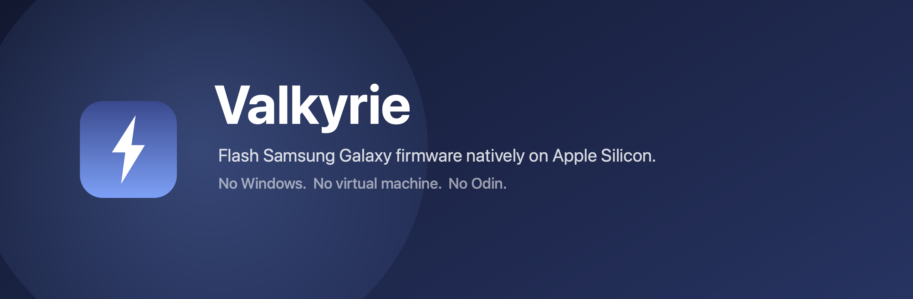
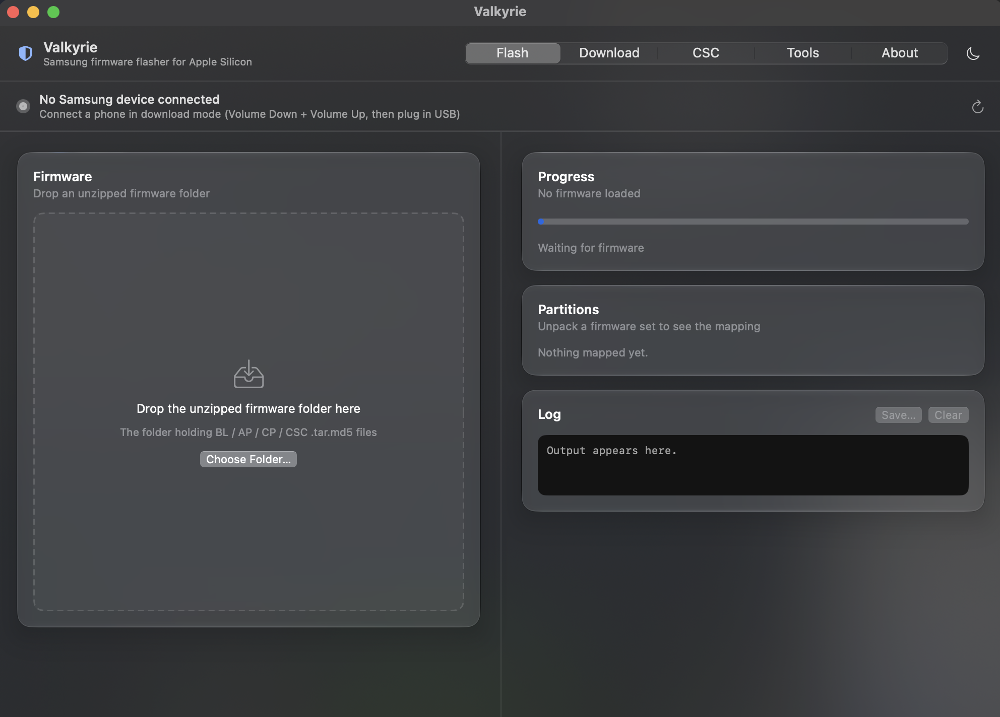
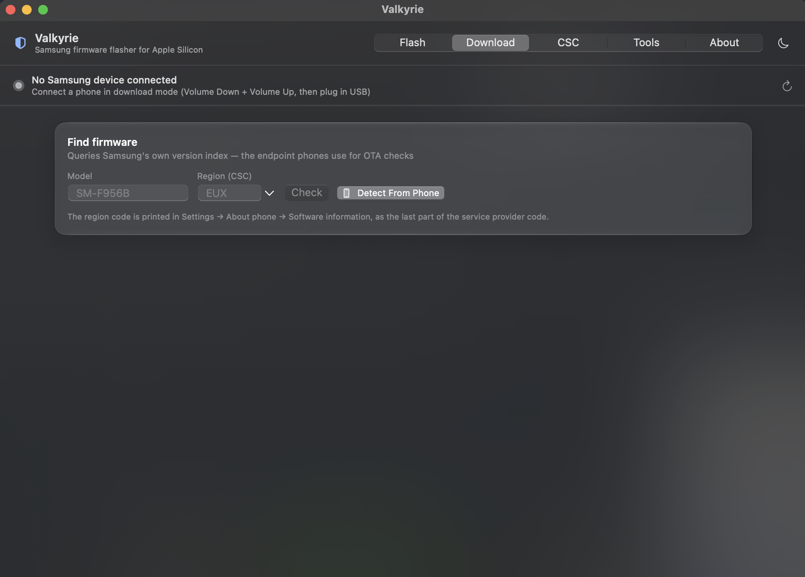
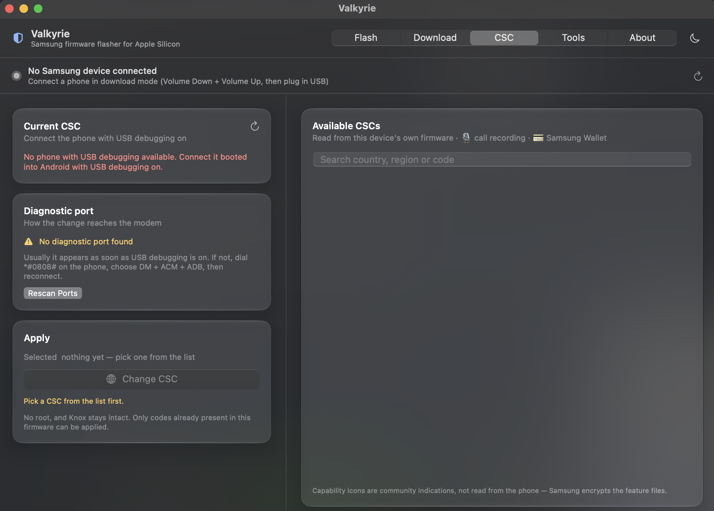
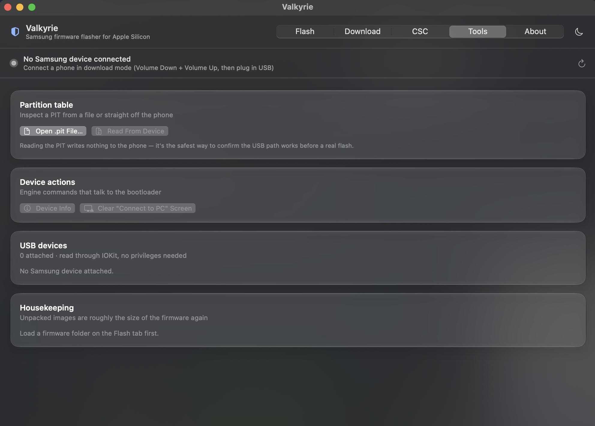
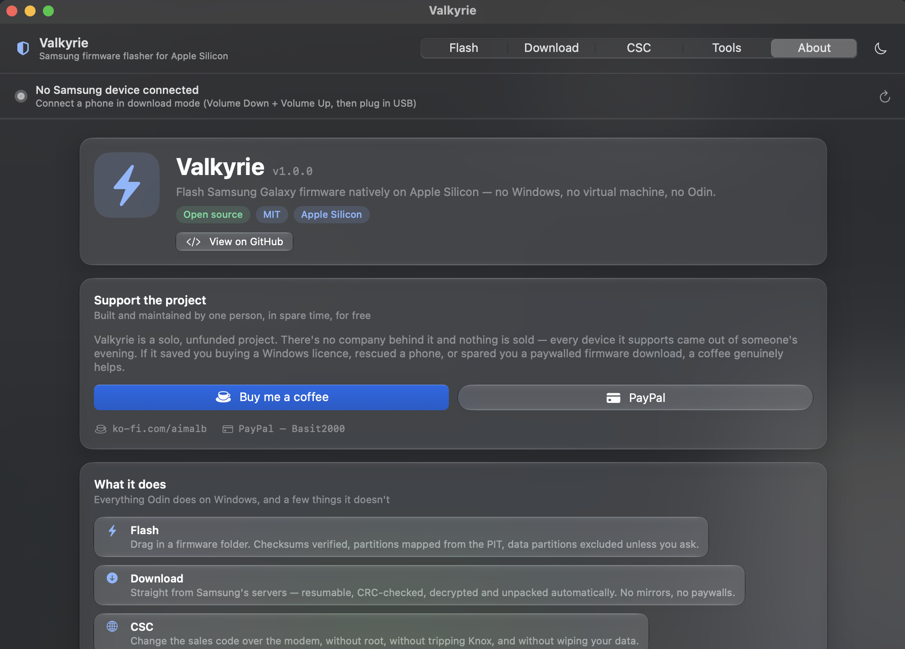

<p align="center">
  
</p>

<p align="center">
  <a href="https://github.com/hashtagbasit/valkyrie/releases"></a>
  
  
  
  <a href="https://ko-fi.com/aimalb"></a>
</p>

---

Odin only runs on Windows and Heimdall is command line only, so I made a proper Mac app
for flashing Samsung phones. Valkyrie is built on top of
[heimdall-apple-silicon](https://github.com/aljosasavic/heimdall-apple-silicon) and does the
whole thing on an M-series Mac: download the firmware, verify it, decrypt it, unpack it and
flash it. Mostly drag and drop.

It can also do two things Odin can't. It downloads firmware straight from Samsung's
servers, and it changes the CSC without root, without tripping Knox and without wiping
your phone.

> ⚠️ Flashing can wipe data, and if it gets interrupted it can brick the phone. Use
> firmware made for your exact model, don't unplug mid-flash, and you're doing this at
> your own risk.

<p align="center">
  
</p>

## What it does

**Flash**
- Drop in an unzipped firmware folder and it finds BL, AP, CP and CSC by itself
- Picks `HOME_CSC` over `CSC` by default so a normal flash keeps your data
- Unpacks the tarballs and decompresses all the lz4 images for you
- Reads the PIT binary itself to work out which image goes to which partition
- Checks the MD5 on every `.tar.md5` before anything gets written
- Shows progress per partition and highlights the one being written
- Has Odin's usual options: auto reboot, re-partition, T-Flash, skip size check

**Download**
- Looks up the current firmware for any model and region from Samsung's own version index
- Shows the AP / CSC / CP versions, the Android version and older builds Samsung still lists
- Downloads directly from Samsung, so you don't need a mirror site or a separate tool
- Decrypts the `.enc4` file and unpacks it in the same go, with progress for every step
- Picks up where it left off if the connection drops

**CSC**
- Reads the current sales code and double checks it with the modem, not just Android
- Lists every code in your firmware with its country and region, read off the phone
- Changes the CSC over the modem's AT interface, with no root, no Knox trip and no data loss
- Reboots the phone and checks the new code actually stuck

**Tools**
- PIT viewer: open a `.pit` file or read the table straight off the phone
- Reading the PIT doesn't write anything, so it's a safe way to check the USB connection works
- Live USB device list and a one click cleanup for unpacked images

Light and dark mode work too, either following the system or set from the title bar.

## How some of it works

**Detecting the phone doesn't need a password.** The USB tree is read through IOKit, so
you can see if the phone is connected from the moment the app opens. Only the actual
flash needs root.

**You only type your password once.** libusb has to claim the USB interface to talk to
the bootloader and macOS only lets root do that. Valkyrie checks your password once to
warm up `sudo`, then every later call uses `sudo -n`, which can't prompt, so the app can't
get stuck waiting on a hidden terminal. The password isn't saved anywhere.

**The progress bar uses Heimdall's real numbers.** Heimdall only prints output when it
thinks it's in a terminal and it redraws the percentage with backspaces (`0%`, then
`\b\b45%`). Valkyrie runs it in a pty through `script` and replays the backspaces and
carriage returns to get clean lines. Both the log and the progress bar come from that.

**The PIT is read directly.** Instead of running `heimdall print-pit` and parsing the text,
Valkyrie reads the 132 byte little endian entries itself, so it doesn't break if the CLI
output ever changes.

## Screens

<table>
  <tr>
    <td width="50%"><br><sub><b>Download</b>: straight from Samsung, resumable and CRC checked</sub></td>
    <td width="50%"><br><sub><b>CSC</b>: every sales code in your firmware, read from the phone</sub></td>
  </tr>
  <tr>
    <td width="50%"><br><sub><b>Tools</b>: PIT viewer, device info, live USB list</sub></td>
    <td width="50%"><br><sub><b>About</b>: made by one person, for free</sub></td>
  </tr>
</table>

## Requirements

An Apple Silicon Mac on macOS 13 or newer.

Download the app, drag it to Applications and open it. The flash engine, lz4 and libusb
are all bundled inside the app, so you don't need Homebrew, Terminal or to compile
anything.

<details>
<summary>What's bundled and why</summary>

Valkyrie uses two command line tools under the hood. They ship inside
`Valkyrie.app/Contents/Resources/bin` so you don't have to build them:

| Component | Licence | Purpose |
|---|---|---|
| `heimdall` | MIT | Talks Samsung's Odin protocol over USB |
| `libusb-1.0.0.dylib` | LGPL-2.1 | USB library the engine links against |
| `lz4` | BSD-2-Clause | Samsung ships partition images lz4 compressed |

The engine gets relinked at build time to load libusb from next to itself instead of from
Homebrew. A `heimdall` you installed yourself at `/opt/homebrew/bin/heimdall` is ignored in
favour of the bundled one. Delete the bundled copy if you want to use yours.

</details>

### First launch

The app is ad-hoc signed, not notarised (notarising needs a paid Apple developer account),
so macOS will say it "cannot be opened because the developer cannot be verified".
**Right-click the app, then Open, then Open again.** You only have to do that once.

## Building

You only need the Xcode Command Line Tools, not full Xcode:

```bash
./build.sh            # builds Valkyrie.app
./build.sh package    # and a release zip
open Valkyrie.app
```

<details>
<summary>Why <code>Local</code> instead of <code>@State</code></summary>

In the macOS 27 SDK `@State` is a macro, and the plugin for that macro only ships with
full Xcode, so it won't expand with just the Command Line Tools. `@StateObject` is older
than macros and works fine, so view state lives in a small `Local<Value>`
`ObservableObject` instead. Everything else (`@Binding`, `@Environment`,
`@EnvironmentObject`, `@FocusState`, `@AppStorage`) works as normal.

</details>

## Usage

1. Download the firmware in the Download tab, or drop in an unzipped folder
2. Put the phone in download mode (see below, it's not always simple)
3. Click **Unpack & Map Partitions**
4. **Look at the partition list.** Anything marked *erases your data* is unticked by
   default. Leave it like that unless you want a factory reset
5. **Flash**

The first boot after a full flash takes a few minutes, just leave it.

## Getting into download mode

Normally it's Volume Down + Volume Up while plugging in USB, then Volume Up to confirm.
On newer phones that often isn't enough:

- **Auto Blocker** (Settings → Security and privacy) blocks USB commands. Turn it off.
- **Maintenance Mode** might be needed. On my Fold6 the phone would show the download
  screen for a second, drop to a blank teal screen and never show up over USB. Going into
  Maintenance Mode first and then rebooting to download mode fixed it. Maintenance Mode is
  Samsung's repair mode and it loosens the USB restrictions that stop a locked phone
  talking to Odin.
- `adb reboot download` works once USB debugging is on, and it's more reliable than the
  buttons.

To check if macOS can see the phone at all:

```bash
ioreg -r -c IOUSBHostDevice -l | grep -E '"idVendor"|"idProduct"|"USB Product Name"'
```

Download mode shows up as `0x04E8:0x685D` and normal/MTP mode as `0x04E8:0x6860`. Don't
use `ioreg -p IOUSB` for this, it's empty on Apple Silicon and makes a working connection
look dead.

## Changing CSC

Valkyrie changes the sales code over the modem's AT interface. I tested it on a Fold6
(Android 16), EUX to INS, and **all my data was still there**, unlike `*#272*<IMEI>#`,
which factory resets.

On the phone, before you start:

- Developer options → **3GPP AT commands** ON. This is the important one. Without it
  `AT+ACTIVATE` just returns nothing, and then the modem answers `OK` to the write and
  quietly throws it away, which looks exactly like it worked.
- Developer options → Default USB configuration → **Transferring files**
- **Auto Blocker off**, screen on and unlocked

The command sequence, if you're curious:

```
AT+DUMPCTRL=1,0      without this, SWATD does nothing
AT+SWATD=0           -> CHANGE TO DDEXE
AT+ACTIVATE=0,0,0    -> +ACTIVATE:0,OK      must confirm, else abort
AT+SWATD=1           -> CHANGE TO ATD
AT+PRECONFG=2,<CSC>  -> +PRECONFG:2,OK
AT+PRECONFG=1,0      -> +PRECONFG:1,<CSC>   verify before rebooting
adb reboot
```

115200 8N1, ending in `\r`. Two things that caught me out: the modem lags one command
behind, so you have to drain the buffer before every write or an old reply looks like a
new success. And `AT+CFUN=1,1` answers `NA` without restarting anything, so the reboot
goes over adb instead.

You can only switch to codes that are already in your firmware. Paid tools pull this same
public sequence from their servers. Valkyrie doesn't need a server for it.

## Data safety

**Picking HOME_CSC over CSC doesn't decide whether your data survives.**

Samsung **factory** (`_fac`) firmware has `userdata.img` and `persist.img` inside the
**AP** file, and AP always gets flashed. So on a factory image, choosing HOME_CSC doesn't
protect anything.

What actually matters is whether these partitions are in the flash:

`USERDATA` · `PERSIST` · `CACHE` · `METADATA` · `OMR` · `EFS`

Valkyrie unticks all of them by default, shows them in red in the partition list and
names each one in the confirmation dialog. Only tick them if you want a wipe.

## How the download works

Samsung's download server uses a whitebox style login. The server sends a 16 character
nonce and the client signs it using a big lookup table that ships inside Samsung's own
software. The old AES-256-CBC method Samloader used doesn't work anymore. The server still
answers, but the old key gets you garbage.

What Valkyrie does:

1. `NF_SmartDownloadGenerateNonce.do` gets a nonce
2. Sign it with the lookup table to get the `Authorization` signature
3. `NF_SmartDownloadBinaryInform.do` gets the file name, size, CRC and key seed
4. **Sign again.** The nonce changes on *every* response and an old one gets a 401
5. `NF_SmartDownloadBinaryInitForMass.do` authorises the download
6. Download from the CDN, then decrypt with AES-128-ECB

The decryption key is the MD5 of a "logic check": each character of the server's
`LOGIC_VALUE_FACTORY` picks a character from the version string by its low nibble.

Two easy mistakes: Samsung shows **three part** version strings but wants **four** in
requests (the AP build repeats as the fourth part), and the nonce change in step 4 applies
to the download request too.

**The lookup table isn't included in this repo.** It gets downloaded once the first time
you use it and cached in `~/Library/Application Support/Valkyrie/`, so there are no
Samsung binaries in here. If Samsung changes the table, downloads will break until it's
updated.

## Known limitations

- **Not notarised.** It's ad-hoc signed so it runs, but Gatekeeper will complain on a new
  Mac until you right-click and Open.
- Some engine actions aren't in the UI yet: `close-pc-screen`, `info`, `--wait`,
  `--usb-log-level`.
- **Samsung usually only serves the latest build.** Older versions under "Previous builds"
  normally fail at the download step, and a mirror is the only way to get those.
- Factory firmware is big (the Fold6 EUX one is around 21GB) and decrypting needs room for
  it twice while it runs.

## Supporting the project

I make Valkyrie on my own in my spare time and give it away for free. There's no company
behind it and nothing to buy. If it saved you a Windows licence, rescued a phone or got you
firmware you'd otherwise pay for, a coffee really helps.

<p align="left">
  <a href="https://ko-fi.com/aimalb"></a>
  <a href="https://paypal.me/Basit2000"></a>
</p>

Can't donate? A star on the repo helps too. Bug reports and "works on my phone" reports
are really welcome, especially with the model, firmware build and CSC.

## Credits

- Original Heimdall: **Benjamin Dobell**, [Glass Echidna](https://glassechidna.com.au/)
- Maintained fork: **Henrik Grimler**, <https://git.sr.ht/~grimler/Heimdall>
- Apple Silicon stall fix: [aljosasavic/heimdall-apple-silicon](https://github.com/aljosasavic/heimdall-apple-silicon)
- Samsung firmware protocol and the lookup table this builds on: [Samloader](https://github.com/samloader/samloader) and [Bifrost](https://github.com/zacharee/SamloaderKotlin)

## License

MIT
